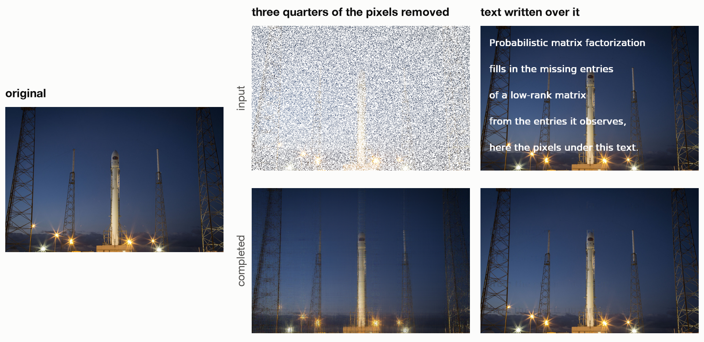

# Probabilistic matrix factorization

Probabilistic matrix factorization fills in the missing entries of a matrix, such as a table of users' movie ratings or a photo with pixels missing, by modelling it as the product of two thin matrices. This repository has notes on the theory and a Python package that fits the model with seven different algorithms and compares them on simulated data and on 100,000 real movie ratings.

It is one part of the work I did as a research assistant to Prof. Omiros Papaspiliopoulos at Bocconi University, which I found interesting enough to put on GitHub. The notes are written with him.

<picture>
  <source media="(prefers-color-scheme: dark)" srcset="figures/hero-dark.png">
  
</picture>

(a) A simulated 300 × 200 matrix of rank 5 plus noise, with half of its entries hidden: how far each algorithm's estimate is from the true matrix as it runs. (b) The error of each algorithm when it predicts MovieLens ratings it has not seen.

## The problem

We observe some entries of an n × p matrix Y and want to predict the rest. In MovieLens the rows are 943 users, the columns are 1,682 movies, and 6% of the entries are observed: the 100,000 ratings, from 1 to 5 stars.

The model gives every row i a vector $u_i$ and every column j a vector $v_j$, both of a small length r, and says that each entry is their dot product plus noise:

$$Y_{ij} = u_i^\top v_j + \varepsilon_{ij}, \qquad \varepsilon_{ij} \sim N(0, 1), \qquad u_i,\ v_j \sim N(0, \lambda^{-1} I).$$

So Y is close to a matrix $UV^\top$ of rank r, and the prior keeps U and V small. For movies, $v_j$ describes a movie by r numbers, $u_i$ describes how much a user likes each of them, and the predicted rating of an unseen movie is $u_i^\top v_j$. The most probable U and V given the observed entries (the MAP estimate) minimize

$$L(U, V) = \frac{1}{2} \sum_{(i,j) \text{ observed}} \left(Y_{ij} - u_i^\top v_j\right)^2 + \frac{\lambda}{2} \left(\lVert U \rVert_F^2 + \lVert V \rVert_F^2\right),$$

a least-squares fit plus a penalty that shrinks U and V towards zero. L is not convex, so it is not obvious that an algorithm will find its minimum. The notes ([notes/pmf.pdf](notes/pmf.pdf)) show what happens:

- With every entry observed, the answer has a closed form. Minimizing L gives the same matrix $UV^\top$ as the convex problem $\min_Z \frac{1}{2}\lVert Y - Z \rVert_F^2 + \lambda \lVert Z \rVert_*$, whose solution is the singular value decomposition of Y with every singular value σ replaced by max(σ − λ, 0).
- Every other stationary point is a saddle, where the fit uses the wrong singular vectors of Y (proved in the notes for λ = 0, checked numerically for λ > 0). In exact arithmetic, alternating least squares started on wrong singular vectors stays on them, but a small random perturbation is usually enough to escape. In a version of the model with a different λ for each column, 196 of 200 gradient runs started next to a saddle reach the minimum ([figure](figures/saddle_escape.png)).
- Missing entries remove the trap. Filling in the missing entries mixes the singular directions, and with even 1% of the entries missing, ALS, gradient descent and soft-impute reach the best solution from every starting point we tried, saddles included ([figure](figures/missing_data.png)).

## Algorithms and results

| algorithm | how it fits the model | MovieLens error |
|---|---|---|
| Gibbs sampling (Salakhutdinov & Mnih 2008) | draws U and V from their posterior distribution and averages the predictions | 0.904 |
| Variational Bayes, VB (Lim & Teh 2007) | approximates the posterior by a simpler distribution and predicts with its mean | 0.919 |
| Alternating least squares (ALS) | solves for U with V fixed, then for V with U fixed; each half-step is a ridge regression | 0.938 |
| Gradient descent | takes gradient steps on U and V together | 0.940 |
| Soft-impute (Mazumder, Hastie & Tibshirani 2010) | fills the missing entries with the current estimate, then applies the closed form | 0.942 |
| Singular value thresholding, SVT (Cai, Candès & Shen 2010) | a related convex method whose rank grows as it runs; stopped when the validation error is lowest | 0.960 |
| Closed form | the closed form applied once, with the missing entries set to zero | 1.045 |

The error is the root mean squared error on a random 20% of the ratings held out for testing, in stars: an error of 0.9 means a typical prediction is about 0.9 stars off. Predicting the average rating for every movie gives 1.122. Each number is the mean over 5 random splits (standard deviation 0.002 to 0.006), and the rank r and λ were chosen for each algorithm on part of the training ratings.

ALS, gradient descent and soft-impute minimize the same loss L, so they end up with almost the same predictions. Gibbs sampling and variational Bayes do not commit to one U and V: they average over all the U and V that fit the data reasonably well, and that predicts unseen ratings better at every rank ([error against rank](figures/movielens_rmse.png)). The simulated matrix in panel (a) shows the same order: the three MAP algorithms stop 8.5% away from the true matrix, the two Bayesian ones 4.9% away, and SVT gets to 5% before it starts fitting the noise.

## Reproduce

```sh
git clone https://github.com/lorenzocaputi/probabilistic-matrix-factorization.git
cd probabilistic-matrix-factorization
python3 -m venv .venv && . .venv/bin/activate
pip install -r requirements.txt
make reproduce
```

`make reproduce` reruns every experiment and redraws every figure in about 40 minutes on a laptop; it downloads MovieLens from grouplens.org. `make check` runs the tests and a small version of each experiment in about a minute, and `make figures` redraws the figures from the saved results in `results/`.

## Application: filling in a photo

<picture>
  <source media="(prefers-color-scheme: dark)" srcset="figures/inpainting-dark.png">
  
</picture>

A colour photo is three matrices of pixel values, one per colour, and a photo made of long straight lines like this launch pad is close to a low-rank matrix. Filling in hidden pixels is then the same problem as predicting unseen ratings. In the middle column, three quarters of the pixels are removed at random and soft-impute rebuilds the photo from the quarter that is left. In the right column, the pixels under the text are treated as missing, which removes the text. The code is in [`applications/image_reconstruction`](applications/image_reconstruction), and this runs it on your own photo:

```sh
python applications/image_reconstruction/matrix_completion_inpaint.py --input photo.jpg --output completed.png --mask random --missing-frac 0.75
```

Photo: the launch of DSCOVR on a Falcon 9, February 2015, by SpaceX, in the public domain.
